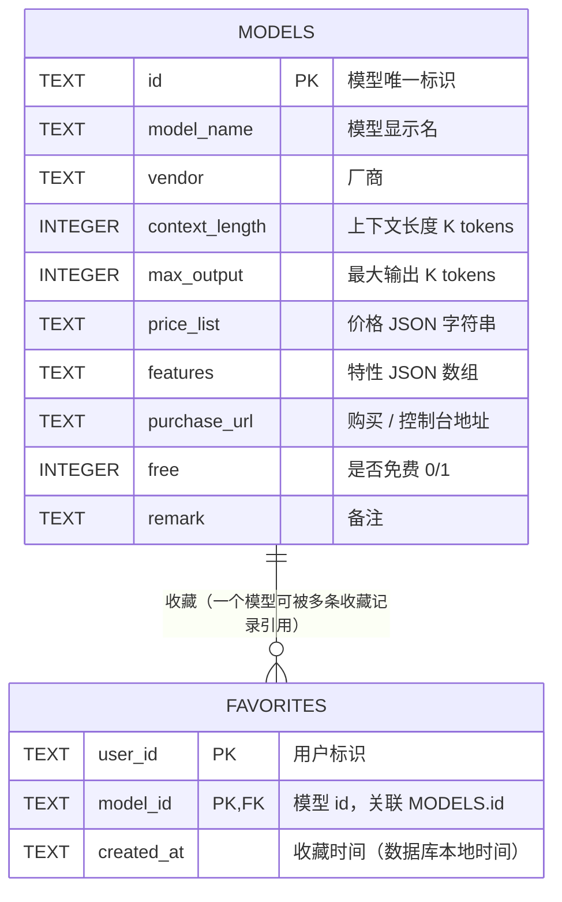

# AI 模型比价 · 后端服务（server）

AI 模型购买对比工具的后端 API 服务，提供模型定价数据的查询与用户收藏管理。
采用 **Node.js + Express + SQLite（better-sqlite3）**，与前端（uni-app / Taro）共用同一套 JS 技术栈。

## 技术栈

| 组件 | 选型 | 说明 |
|---|---|---|
| 运行时 | Node.js 18+ | ESM 模块（`"type": "module"`） |
| Web 框架 | Express 4 | RESTful 路由 + 中间件 |
| 数据库 | SQLite（better-sqlite3） | 文件型数据库，同步 API，零配置 |

## 目录结构

```
server/
├── src/
│   ├── app.js                 # 应用入口：中间件、路由挂载、404 兜底、统一错误处理
│   ├── routes/                # 路由层：定义 HTTP 接口，解析参数，统一 JSON 响应
│   │   ├── model.routes.js
│   │   └── favorite.routes.js
│   ├── services/              # 业务层：参数校验、业务规则、组合 DAO
│   │   ├── model.service.js
│   │   └── favorite.service.js
│   ├── dao/                   # 数据访问层：封装 SQL，负责字段映射
│   │   ├── db.js              #   SQLite 连接 + 建表（models / favorites）
│   │   ├── model.dao.js
│   │   └── favorite.dao.js
│   ├── data/
│   │   └── models.data.js     # 模型定价演示数据（seed 数据源）
│   └── seed/
│       └── seed.js            # 数据初始化脚本：清空并批量写入 models 表
├── docs/
│   └── 数据库字段说明.md        # 数据库字段、关系、SQL 示例的详细文档
└── package.json
```

**请求分层流转**：`HTTP 请求 → routes → services → dao → SQLite → JSON 响应`

## 快速开始

```bash
cd server
npm install        # 安装依赖（better-sqlite3 为原生模块，需本地编译）

npm run seed       # 初始化数据：写入 10 条模型定价数据到 data/models.db
npm run dev        # 开发模式启动（node --watch 热重载），端口 3000
# 或
npm start          # 生产模式启动
```

启动后访问 <http://localhost:3000>，可用 `curl` 验证：

```bash
curl http://localhost:3000/api/models                     # 模型列表
curl "http://localhost:3000/api/models?keyword=glm&vendor=智谱GLM"  # 筛选
curl http://localhost:3000/api/models/deepseek-chat       # 模型详情
curl "http://localhost:3000/api/favorites?userId=u1"      # 收藏列表
```

> 端口可通过环境变量 `PORT` 修改，默认 `3000`。

## API 文档

### 统一响应格式

```json
{ "code": 0, "message": "ok", "data": null }
```

- `code`：`0` 表示成功；非 `0` 为错误码，与 HTTP 状态码一致
- `message`：提示信息
- `data`：业务数据（无数据时为 `null`）

### 模型接口

#### GET /api/models —— 模型列表

查询参数（均可选）：

| 参数 | 类型 | 说明 |
|---|---|---|
| keyword | string | 关键字，模糊匹配模型名/厂商（不区分大小写） |
| vendor | string | 厂商名，精确匹配 |

示例：`GET /api/models?keyword=glm&vendor=智谱GLM`

#### GET /api/models/:id —— 模型详情

- 路径参数 `:id` 为模型 id（如 `deepseek-chat`）
- 模型不存在时返回 `404`：`{ "code": 404, "message": "模型不存在", "data": null }`

模型对象字段（camelCase）：

```json
{
  "id": "deepseek-chat",
  "modelName": "deepseek-chat",
  "vendor": "DeepSeek",
  "contextLength": 128,
  "maxOutput": 8,
  "priceList": { "input": 0.8, "output": 2, "cacheHit": 0.2 },
  "features": ["通用对话"],
  "purchaseUrl": "https://platform.deepseek.com",
  "free": false,
  "remark": "V3.2 系列，非思维链模型"
}
```

> 注意：`priceList` 结构因厂商而异（部分含 `cacheHit`、`peak/offPeak`），前端需按"字段是否存在"做兼容展示。

### 收藏接口

> 本项目未实现登录，`userId` 由前端在请求中显式传入。

#### GET /api/favorites?userId=xxx —— 收藏列表

返回该用户收藏的模型 id 数组（按收藏时间倒序）。缺少 `userId` 返回 `400`。

#### POST /api/favorites —— 添加收藏

请求体（JSON）：

```json
{ "userId": "u1", "modelId": "deepseek-chat" }
```

- 参数为空返回 `400`；模型不存在返回 `404`
- 重复收藏被数据库静默忽略（天然幂等）

#### DELETE /api/favorites/:modelId?userId=xxx —— 取消收藏

- 路径参数 `:modelId` 指定模型，查询参数 `userId` 指定用户
- 幂等：删除不存在的收藏也返回成功

## 数据库



- 数据库文件：`server/data/models.db`（SQLite，首次 seed 时自动创建）
- 两张表：`models`（模型定价）、`favorites`（用户收藏），关系为 `favorites.model_id → models.id`（N:1）
- 关键设计：
  - `price_list` / `features` 以 **JSON 字符串** 存储（各厂商价格结构不统一，读取时 `JSON.parse` 还原）
  - `favorites` 使用 `(user_id, model_id)` **联合主键**，配合 `INSERT OR IGNORE` 实现重复收藏幂等
  - 字段在库中为 snake_case，DAO 层转换为 camelCase 领域对象供 JS 使用
  - 布尔类型用 `0/1` 整数（SQLite 无布尔类型）

完整字段说明、表关系与常用 SQL 见 [docs/数据库字段说明.md](docs/数据库字段说明.md)。

## 错误处理约定

- 业务错误在 service 层抛出带 `status` 的异常（如 `400` 参数不合法、`404` 模型不存在）
- 路由层通过 `next(err)` 交给 `app.js` 的全局错误中间件统一处理
- 未显式设置状态码的意外异常统一返回 `500`，且 `message` 不对外暴露（防信息泄露）

## npm scripts

| 命令 | 作用 |
|---|---|
| `npm run dev` | 开发模式（`node --watch` 热重载） |
| `npm start` | 生产模式启动 |
| `npm run seed` | 初始化模型定价数据（可重复执行，结果一致） |
